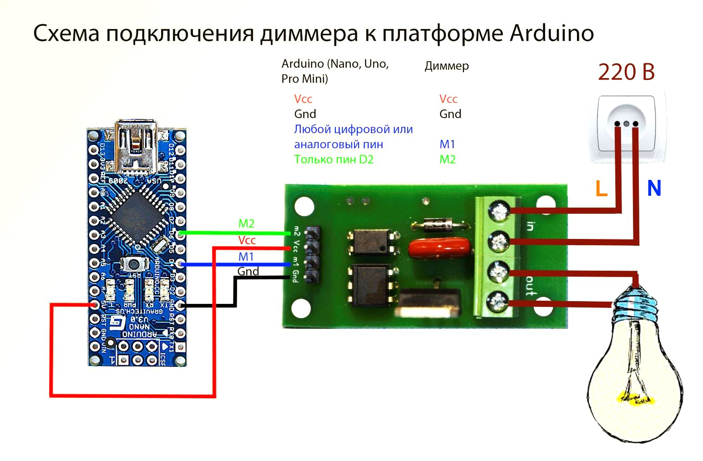

# Диммер 220В для Arduino и ESP8266

Данный диммер позволяет управлять нагрузками, подключенными в промышленную сеть 220В мощностью до 2 кВт с помощью контроллера Arduino. Есть библиотеки для Arduino и ESP8266. С некоторыми ограничениями можно использовать диммер с мини-компьютерами Raspberry Pi, Orange Pi и др.

**Применение**:
- Управление освещением
- Управление двигателями
- Управление силовыми нагревателями и т. д.

**Характеристики**:
- Напряжение: до 280 VAC / 50Hz
- Рекомендуемая мощность без радиатора: до 150 Вт
- Рекомендуемая мощность с радиатором: от 150 Вт до 2000 Вт
- Максимальная мощность с радиатором: до 3000 Вт
- Напряжение падения на ключе 1В ±0.1В

**Преимущества**:
- Удобная компоновка платы:
    - Небольшой размер (50x25 мм)
    - 4 крепежных отверстия по периметру
    - Силовой ключ направлен в сторону боковой грани, что позволяет использовать радиатор любого размера и формы в зависимости от мощности (если он нужен)
- Полная гальвано-развязка силовой и слаботочной части
- Наличие светодиода для индикации работы диммера
- Предусмотрен RC снаббер (для сглаживания перепадов тока на ключе, в случае работы на высоких токах или с индуктивными нагрузками типа моторов)
- Уменьшен нагрев компонентов фазовой детекции
- Удобная библиотека:
    - работа в неблокируемом режиме
    - реализованы различные режимы управления для конкретного типа нагрузки (детально в Тех-док)
    - возможность каскадирования (работа нескольких димеров одновременно от одного контроллера)
    - присутствуют примеры

**Интерфейс**:

