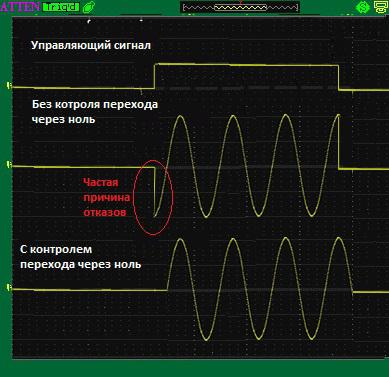
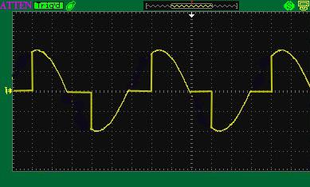
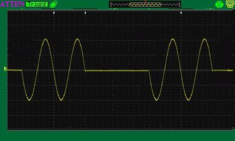

# Диммер для помпи

## Теорія

У DeLonghi EC 685 встановлена вібраційна помпа (зазвичай Ulka E4 / E5 або аналогічна). Всередині знаходиться діод, який пропускає лише одну півхвилю змінного струму (50 Гц), і поршень здійснює 50 коливань на секунду завдяки електромагніту та зворотності пружини.

Зміна напруги/фази симістором за допомогою диммера змінює силу та амплітуду руху поршня, що дозволяє регулювати продуктивність (потік) і, відповідно, впливаєте на тиск у системі.

**Регулювання диммером (Phase Cut Control):**

1. Що робить: Регулює продуктивність (потік / Flow Rate) самієї помпи.
2. Принцип: Ви змінюєте силу та об'єм прокачування води за одиницю часу. Тиск при цьому є лише похідним результатом від того, скільки води дає помпа і як сильно їй чинить опір кавова таблетка.
3. Результат: Ви можете плавно контролювати швидкість наростання тиску, робити м'яку преінфузію (попереднє змочування на 2-3 бар) або знижувати потік наприкінці проливу (Pressure Profiling).

### Нюанси та обмеження (Що треба врахувати)

1. Нелінійність діапазону (Dead Zone):
    - Вібраційна помпа має мінімальний поріг спрацьовування. При зрізанні понад 50-60% фази поршень просто не зможе подолати опір пружини та тиск залишкової води.
    - Робочий діапазон диммування буде приблизно від 30% до 100% потужності. Нижче 30% помпа перестає прокачувати воду і починає лише тихо гудіти.

2. Діод у помпі та фазове зрізання:
    - Оскільки помпа живлюється через внутрішній діод, детектор нуля контролера фіксує обидва переходи струму через нуль (кожні 10 мс для 50 Гц), але помпа реагує лише на один півперіод.
    - Бібліотека працює коректно, але через наявність діода регулювання може відчуватися трохи «ступінчастим» або чутливим у певних діапазонах затримки.

3. Залежність тиску від кошика та таблетки:
    - Диммер регулює потік (потужність помпи), а не безпосередньо тиск.
    - Підсумковий тиск у ситочку залежить від опору кавової таблетки (помелу, трамбування) та наявності аварійного клапана (OPV). Якщо кава змелена занадто крупно, зниження потужності помпи лише зменшить швидкість протоку.

### Ключові поради для реалізації
Калібрування MIN / MAX у коді: Знайдіть експериментальним шляхом мінімальне значення симістора, при якому помпа ще створює стабільний потік без «залипання» поршня, і обмежте діапазон у програмі.

**Важливо:** Нам потрібен диммер з детектором нуля (Zero-Cross) та затримкою імпульсу відкриття симістора (Phase Cut Dimming / фазове регулювання).

## Диммер 220В для Arduino и ESP8266

Данный диммер позволяет управлять нагрузками, подключенными в промышленную сеть 220В мощностью до 2 кВт с помощью контроллера Arduino. Есть библиотеки для Arduino и ESP8266. С некоторыми ограничениями можно использовать диммер с мини-компьютерами Raspberry Pi, Orange Pi и др.

**Применение**:
- Управление освещением
- Управление двигателями
- Управление силовыми нагревателями и т. д.

**Характеристики**:
- Напряжение: до 280 VAC / 50Hz
- Рекомендуемая мощность без радиатора: до 150 Вт
- Рекомендуемая мощность с радиатором: от 150 Вт до 2000 Вт
- Максимальная мощность с радиатором: до 3000 Вт
- Напряжение падения на ключе 1В ±0.1В

**Преимущества**:
- Удобная компоновка платы:
    - Небольшой размер (50x25 мм)
    - 4 крепежных отверстия по периметру
    - Силовой ключ направлен в сторону боковой грани, что позволяет использовать радиатор любого размера и формы в зависимости от мощности (если он нужен)
- Полная гальвано-развязка силовой и слаботочной части
- Наличие светодиода для индикации работы диммера
- Предусмотрен RC снаббер (для сглаживания перепадов тока на ключе, в случае работы на высоких токах или с индуктивными нагрузками типа моторов)
- Уменьшен нагрев компонентов фазовой детекции
- Удобная библиотека:
    - работа в неблокируемом режиме
    - реализованы различные режимы управления для конкретного типа нагрузки (детально в Тех-док)
    - возможность каскадирования (работа нескольких димеров одновременно от одного контроллера)
    - присутствуют примеры

**Интерфейс:**

**Программные ограничения:**

Для контроля фазы использовать только D2 (порт M2 диммера подключать к порту D2 АРДУИНО)!!!

Не использовать пины D9 и D10 для ШИМ Analog.Write()!!! только цифровой выход/вход digitalWrite() и digitalRead()

Методы управления (библиотечные функции)

1) Твердотельное реле с котролем перехода через ноль

Данный метод реализован с помощью библиотечной функции SSR_switch – это полная реализация твердотелого реле (SSR) С КОНТРОЛЕМ ПЕРЕХОДА ЧЕРЕЗ НОЛЬ.

Такое реле выгодно отличается от обычного тем, что оно включает нагрузку синхронно с переходом переменного сетевого напряжения через ноль, чтобы избежать скачка тока на реле, от чего чаще всего реле БЕЗ контроля перехода через ноль и выходят и строя.

2) Традиционное симисторное диммирование («сечение полуволн»)

 Данный метод реализован с помощью библиотечной функции Value – работает по принципу обычного симисторного диммера, где регуляция мощности происходит путем «отсекания» от синусоиды части тока. Таким образом уменьшается действующее напряжение на выходе, а с ним и выходная мощность.

**Подходит** для управления освещением и моторами.

**Не рекомендовано** для управления очень мощными нагрузками.

3) Димминг полуволнами

 Данный метод реализован с помощью библиотечной функции Heater - это метод управления мощностью для силовых нагревателей или других высокоинерционных нагрузок. Отличается от обычного диммирования с помощью функции Value как в примере AC_Dimmer_FADE тем, что включения и выключения нагрузки происходят синхронно с переходами через ноль. Это обеспечивает более надежную работу устройства с очень мощной нагрузкой подобно как функция SSR_switch.

**НЕ ПОДХОДИТ** для управления освещением и двигателем, так как здесь очень большой период диммирования для обеспечения надежности при работе с высокомощными нагрузками, поэтому когда подключить лампочку и попробовать управлять ею с помощью функции Heater она БУДЕТ МЕРЦАТЬ

Примеры использования всех перечисленных методов управления есть в библиотеке, ссылка на которую представлена ниже.

**Версия библиотеки 2.0:**
- Реализована возможность одновременной работы нескольких устройств (до 5 шт с возможностью увеличения их количества).
- Все библиотечные функции работают в неблокирующем режиме.
- Добавлено подсвечивание функций в библиотеке среды программирования Arduino IDE
- Добавлен пример скетча трёхканальной работы диммера с потенциометрами где каждый диммер можно независимо регулировать при помощи своего потенциометра.
- Исправлены мелкие ошибки

[Библиотека](https://github.com/serhiy23412/AC_dimmer-dmr-0.2.1)

