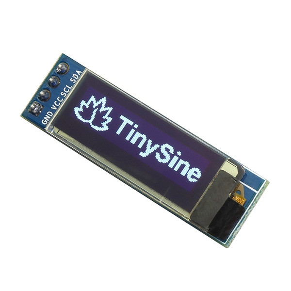

# Дисплей для виведення показників

У якості дисплея використовується OLED дисплей 0.91" I2C 128x32.

## Технічні характеристики OLED дисплей 0.91" I2C 128x32

Яркий, экономичный, очень контрастный OLED дисплей достойно украсит любую Вашу конструкцию, для которой важны размеры и внешний вид. Контрастность дисплея позволит уверенно считывать с него информацию даже при очень ярком свете. Простое подключение и распространенный I2C интерфейс позволит подключить несколько дисплеев к любому микроконтроллеру или мини-компьютеру.

**Характеристики:**
- Размер экрана 0.91"
- Тип экрана OLED
- Разъем 4-пин
- напряжение питания 3.3В - 6В
- Разрешение дисплея 128*32
- Толщина 12 мм (с разъемом)
- Ширина 12 мм
- Длина 38 мм
- Вес 3.0 грамма

**Спецификация:**
- Драйвер OLED модуля: SSD1306
- Угол обзора: > 160 градусов
- Разъем: 4-pin
- Напряжение питания: 3.3-6V
- Уровни входных сигналов: 3.3V / 5V
- Цоколевка разъема:
    - GND: Общий
    - VCC: Напряжение питания
    - SDA: Шина данных
    - SCL: Шина тактирования данных

